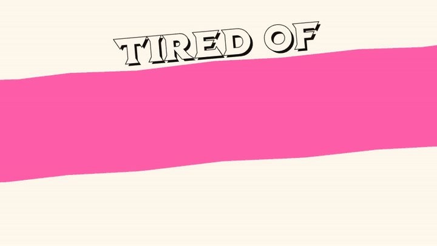
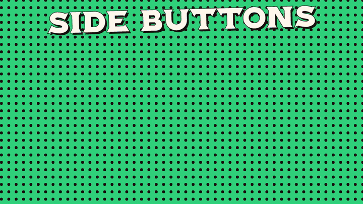
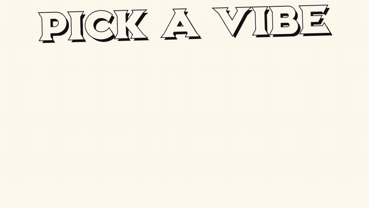
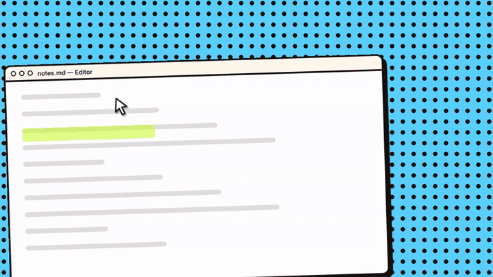
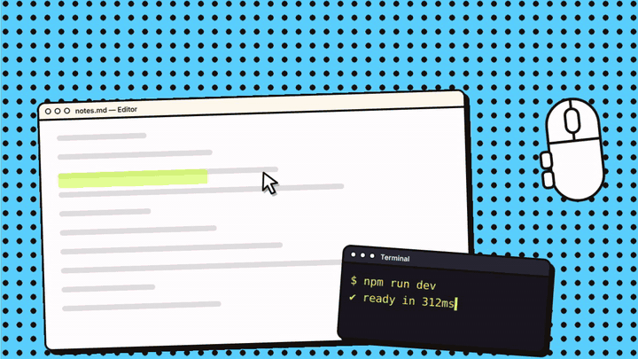

<div align="center">

<picture>
  <source media="(prefers-color-scheme: dark)" srcset="assets/cursorpie-logo-white.png">
  
</picture>

### Your actions, one gesture away.

**Hold a mouse button or a finger on your trackpad. Flick toward an action. Release.**

A configurable pie menu for your cursor — available on macOS, Windows and Linux, with a mouse or a trackpad.

[**Visit the website**](https://sebastvnd.github.io/cursorpie/) · [Download latest release](https://github.com/sebastvnd/cursorpie/releases/latest) · [Explore the docs](https://sebastvnd.github.io/cursorpie/index.html?doc=docs/README.md)

[](https://github.com/sebastvnd/cursorpie/actions/workflows/ci.yml)
[](https://github.com/sebastvnd/cursorpie/releases)
[](LICENSE)


[Installation](docs/user/install.md) · [User guide](docs/user/README.md) · [Configuration](docs/user/configuration.md) · [Contributing](CONTRIBUTING.md) · [Changelog](CHANGELOG.md)

</div>

---

## What is CursorPie?



CursorPie puts a radial menu right under your pointer. Hold the middle mouse button (or touch and hold a trackpad), move toward the action you need, then release. No hunting through menus and no need to remember a long list of shortcuts.

A slice can send a keyboard shortcut, open an application, URL or file, run a command, switch a mouse-button mode, or open a submenu. You can keep a general menu and create a different profile for each application.

Built with **Rust** and [egui](https://github.com/emilk/egui), CursorPie is inspired by [Kando](https://github.com/kando-menu/kando).

## Highlights

- **A quick, natural gesture.** Hold for 150 ms by default, flick toward a slice, and release. Press Space while the pie is open to open Settings.
- **A menu for every app.** Keep a general pie and create app-specific profiles for the tools you use most.
- **Mouse or trackpad.** Touch and hold a trackpad instead of pressing a button, on macOS, Windows and Linux (X11 and Wayland). It is off by default and uses the same pie, timings and profiles; see [Trackpad](#trackpad).
- **Useful mouse buttons.** Assign actions to back, forward and other supported extra buttons with configurable modes.
- **Actions that fit your workflow.** Trigger shortcuts, open apps, links and files, run shell commands, or chain actions into a sequence.
- **Nested menus.** Organize up to 8 slices per ring and 5 levels of submenus.
- **Room to experiment.** Undo and redo edits in Settings, with automatic backups of previous saves.
- **Easy to share.** Export a profile, including its icons, as a single JSON file.
- **Private and lightweight.** No account or telemetry. Its only network use is a daily look for a newer release when you open Settings (which you can switch off) and, when you press **Install update**, the download of that release. The menu stays out of the way while idle.

A clickable mouse wheel, or a trackpad, is enough to get started. Some features and button options vary by operating system; see [Platform support](#platform-support).

## A quick tour

### Any action

A slice can send shortcuts, open apps, URLs and files, run shell commands, switch mouse modes, open submenus or run a flow. See [Using the pie](docs/user/using-the-pie.md#slices-and-actions).


### Nested submenus

Up to 8 slices per ring and 5 levels of submenus.


### A pie per app

Keep a general pie and give the tools you use most their own. See [Profiles and mouse buttons](docs/user/profiles-and-buttons.md).


### Mouse side buttons

Back and forward can act as undo and redo, or run any action you assign to a mode.



### Flows

Chain shortcuts, apps, waits, conditions and loops into one slice. See [Flows](docs/user/flows.md).


### The settings editor

Build menus, tune the gesture and undo any edit. See [Settings and backups](docs/user/settings.md).


### Themes and sharing

Pick a theme, then export a profile with its icons as a single JSON file. See [Themes](docs/user/themes.md).



### Private and open source

No account, no telemetry, MIT license, built in Rust.


## Download and install

Get the latest ready-to-install build from [GitHub Releases](https://github.com/sebastvnd/cursorpie/releases/latest):

| Platform                                | Package                                                                                                                                                                                                              |
| --------------------------------------- | -------------------------------------------------------------------------------------------------------------------------------------------------------------------------------------------------------------------- |
| **macOS 11+** (Intel and Apple silicon) | [Universal DMG](https://github.com/sebastvnd/cursorpie/releases/latest/download/CursorPie-macos-universal.dmg)                                                                                                       |
| **Windows 10/11** (recommended)         | [Setup installer](https://github.com/sebastvnd/cursorpie/releases/latest/download/CursorPie-windows-setup.exe) · [ZIP bundle](https://github.com/sebastvnd/cursorpie/releases/latest/download/CursorPie-windows.zip) |
| **Ubuntu 24.04+** (x86_64)              | [Ubuntu package](https://github.com/sebastvnd/cursorpie/releases/latest/download/CursorPie-ubuntu-24.04-x86_64.tar.gz)                                                                                               |
| **Fedora 44** (x86_64)                  | [Fedora package](https://github.com/sebastvnd/cursorpie/releases/latest/download/CursorPie-fedora-44-x86_64.tar.gz)                                                                                                  |

For step-by-step instructions, including the Linux `install.sh` script and macOS permissions, read the [installation guide](docs/user/install.md). Build artifacts from individual CI runs are temporary; public downloads are published with GitHub Releases when a version tag is pushed.

## Try it

1. Install and launch CursorPie.
2. Hold the **middle mouse button**, or touch and hold your **trackpad**, for a split second (150 ms by default).
3. Move the pointer toward a slice.
4. Release to run the action.



Changed your mind? Release in the middle of the pie to cancel:



No middle button? Turn on _Open the pie with a trackpad hold_ in **Settings > Behavior > Trackpad** and touch and hold the trackpad instead. Press Space while the pie is open (or hold the trigger in the center of the pie, if you turned that on) to open Settings and customize your menus. The [user guide](docs/user/README.md) explains gestures, actions, profiles and settings in detail.

## Platform support


| Platform                   | Status                 | Notes                                                                                                                                                                                                                                                                                                                                                                                                                                   |
| -------------------------- | ---------------------- | --------------------------------------------------------------------------------------------------------------------------------------------------------------------------------------------------------------------------------------------------------------------------------------------------------------------------------------------------------------------------------------------------------------------------------------- |
| **macOS 11+**              | Supported              | Requires the Accessibility permission. The trigger can be the middle button or one of three extra mouse buttons. Any trackpad works; Force Touch trackpads also give haptic ticks.                                                                                                                                                                                                                                                      |
| **Windows 10 (1809) / 11** | Supported · stable     | No special permission required. The middle button is the only trigger; Windows exposes the back and forward buttons as extra buttons. Trackpad hold needs a precision touchpad.                                                                                                                                                                                                                                                         |
| **Linux, X11 session**     | Supported · pre-stable | x86_64 packages for Ubuntu 24.04+ and Fedora 44. Nothing to set up and no permission needed. The whole feature set works; the manual checklist on real desktops is still being completed. There is no tray icon yet. Trackpad hold needs your user in the `input` group.                                                                                                                                                                |
| **Linux, Wayland session** | Experimental           | Works on any compositor for mouse capture and shortcuts, and needs the udev rule `70-cursorpie.rules`. Per-app profiles work on KDE Plasma, Hyprland, GNOME (with the extension) and, mostly, Sway; COSMIC and niri have none. Written and tested, but not yet run on real Plasma 6.8, GNOME, Hyprland or Sway machines ([status](docs/developer/WAYLAND_SUPPORT.md#implementation-status)). Trackpad hold works through the udev rule. |

KDE Plasma 6.8 and GNOME 50 no longer offer an X11 session, so on those desktops you are on Wayland. Read [CursorPie on Linux](docs/user/linux.md) and [Known issues](docs/user/known-issues.md) before installing.

### Trackpad


Touch and hold opens the pie, moving the finger hovers a slice, lifting runs it, and one more finger that taps or clicks switches the mode. It is **off by default** and works on all three systems:

| System                                             | What is read                                                                                              | Needs                                                                                                                                              |
| -------------------------------------------------- | --------------------------------------------------------------------------------------------------------- | -------------------------------------------------------------------------------------------------------------------------------------------------- |
| **macOS**                                          | any trackpad, through Apple's private `MultitouchSupport` framework (loaded only while the feature is on) | the Accessibility permission; haptic ticks on a Force Touch trackpad                                                                               |
| **Windows**                                        | a _precision_ touchpad, through Raw Input                                                                 | nothing extra; no haptics                                                                                                                          |
| **Linux (X11: pre-stable, Wayland: experimental)** | a touchpad, from `/dev/input/event*`                                                                      | your user in the `input` group (`sudo usermod -aG input $USER`, then log out and in), or on Wayland the udev rule `70-cursorpie.rules`; no haptics |

The trackpad paths are new and have not been verified on every device yet; see [Known issues](docs/user/known-issues.md) and the [user guide](docs/user/trackpad.md). On Linux, `cursorpie --touchpad-debug` shows which step fails.

## Documentation

| Topic                                         | Guide                                           |
| --------------------------------------------- | ----------------------------------------------- |
| Install a release or build from source        | [Installation](docs/user/install.md)            |
| Learn the basics in five minutes              | [Getting started](docs/user/getting-started.md) |
| Use Linux (X11 or Wayland)                    | [CursorPie on Linux](docs/user/linux.md)        |
| Learn gestures, slices, profiles and settings | [User guide](docs/user/README.md)               |
| Read or edit `config.json`                    | [Configuration](docs/user/configuration.md)     |
| Check current limitations                     | [Known issues](docs/user/known-issues.md)       |
| Debug a problem                               | [Debugging](docs/DEBUGGING.md)                  |
| Contribute or build the project               | [Contributing](CONTRIBUTING.md)                 |
| Browse developer notes and design records     | [Developer guide](docs/developer/README.md)     |
| Everything, by audience                       | [Documentation index](docs/README.md)           |
| See what changed between versions             | [Changelog](CHANGELOG.md)                       |

The same guides are available in the [CursorPie website](https://sebastvnd.github.io/cursorpie/), which renders the Markdown files directly from the repository.

## Build from source

To compile CursorPie yourself, install [Rust](https://rustup.rs) 1.88 or later and follow the platform-specific prerequisites in [CONTRIBUTING.md](CONTRIBUTING.md).

```sh
git clone https://github.com/sebastvnd/cursorpie.git
cd cursorpie
cargo run --release
```

To run the checks used by CI:

```sh
cargo tools hooks install   # once per clone
cargo tools ci              # format, lint, tests and documentation checks
```

## Contributing

Contributions, bug reports and ideas are welcome. Please read [CONTRIBUTING.md](CONTRIBUTING.md) for the project workflow, development setup and pull-request guidelines.

Found a bug? [Open an issue](https://github.com/sebastvnd/cursorpie/issues) and include your operating system, desktop/session type (when relevant), and steps to reproduce it.

## Privacy

CursorPie runs locally. It has no account system or telemetry. Its only network connections are the update check (when you open Settings it asks GitHub, at most once a day, for the newest release) and, only when you press **Install update**, the download of that release; GitHub sees your IP address and the CursorPie version. Switch the check off with **About > Updates > Check for updates automatically**.

## License

CursorPie is released under the [MIT License](LICENSE). It uses egui/eframe, tray-icon, serde and image, and is inspired by [Kando](https://github.com/kando-menu/kando).
