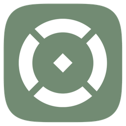
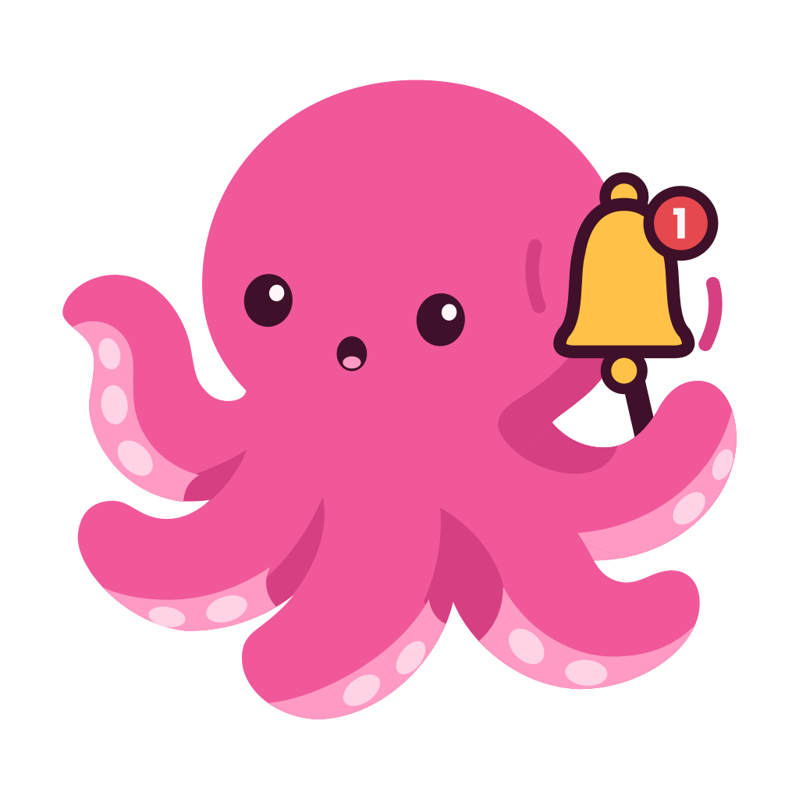
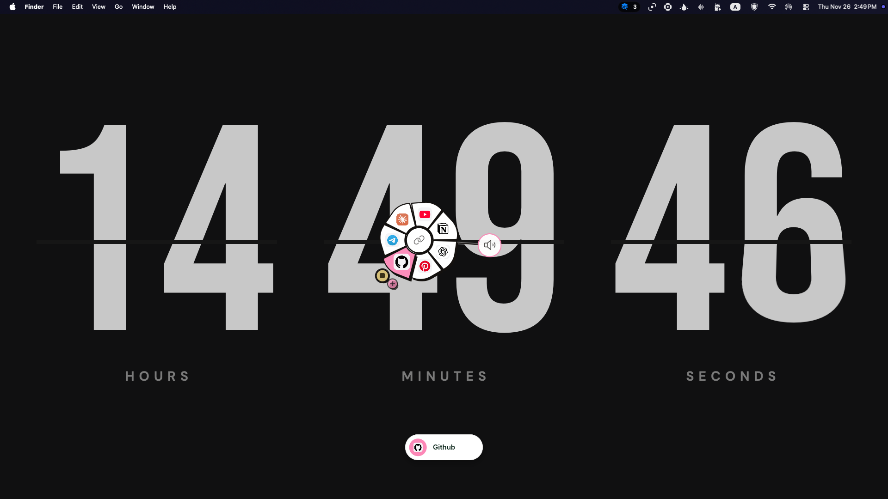
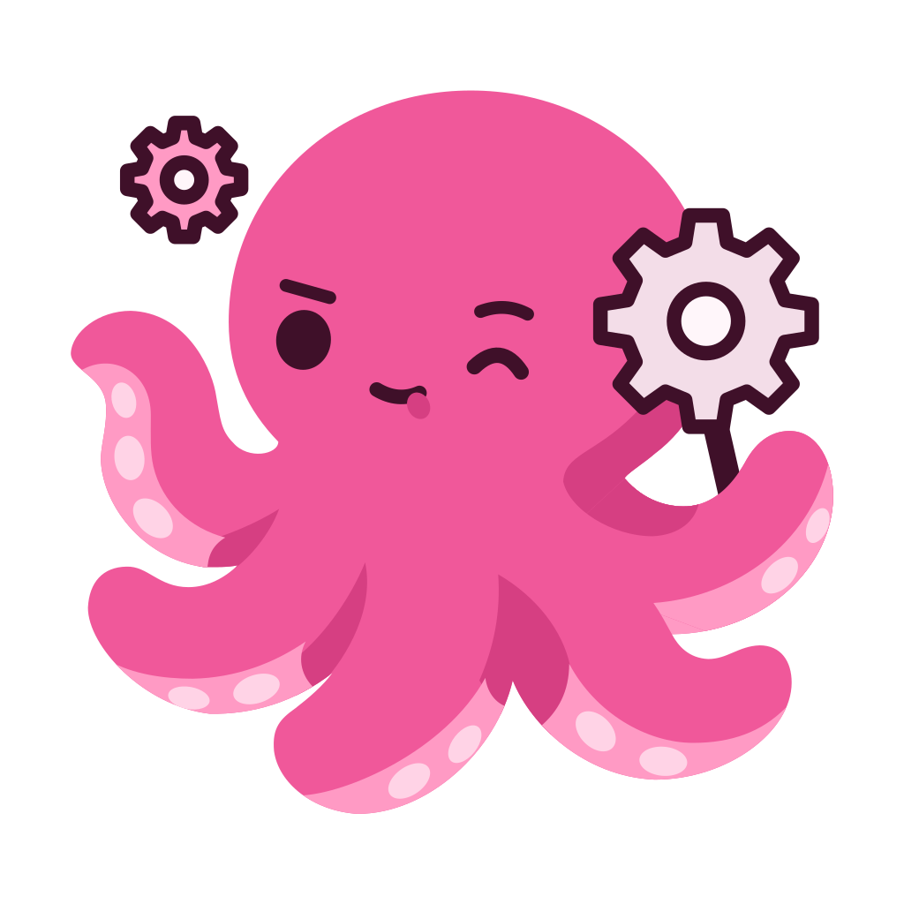

<div align="center">
    <p align="center">
    
    </p>
    <h1 align="center">CursorPie</h1>
    <p align="center">
      <strong>Your actions, one gesture away.</strong><br>
      Hold a mouse button or a finger on your trackpad. Flick toward an action. Release.
    </p>

  <!-- Primary actions -->
  <p align="center">
    <a href="https://sebastvnd.github.io/cursorpie/"></a>
    <a href="https://github.com/sebastvnd/cursorpie/releases/latest"></a>
    <a href="https://sebastvnd.github.io/cursorpie/index.html?doc=docs/README.md"></a>
    <br>
    <a href="docs/user/install.md"></a>
    <a href="docs/user/README.md"></a>
    <a href="docs/user/configuration.md"></a>
    <a href="CONTRIBUTING.md"></a>
    <a href="CHANGELOG.md"></a>
  </p>

</div>

---

<h2>
  
      What is CursorPie?
</h2>



A slice can send a keyboard shortcut, open an application, URL or file, run a command, switch a mouse-button mode, or open a submenu. You can keep a general menu and create a different profile for each application.

Built with **Rust** and [egui](https://github.com/emilk/egui), CursorPie is inspired by [Kando](https://github.com/kando-menu/kando).

<h2>
  
      Download and install
</h2>

Get the latest ready-to-install build from [GitHub Releases](https://github.com/sebastvnd/cursorpie/releases/latest):

| Platform                                | Package                                                                                                                                                                                                              |
| --------------------------------------- | -------------------------------------------------------------------------------------------------------------------------------------------------------------------------------------------------------------------- |
| **macOS 11+** (Intel and Apple silicon) | [Universal DMG](https://github.com/sebastvnd/cursorpie/releases/latest/download/CursorPie-macos-universal.dmg)                                                                                                       |
| **Windows 10/11** (recommended)         | [Setup installer](https://github.com/sebastvnd/cursorpie/releases/latest/download/CursorPie-windows-setup.exe) · [ZIP bundle](https://github.com/sebastvnd/cursorpie/releases/latest/download/CursorPie-windows.zip) |
| **Ubuntu 24.04+** (x86_64)              | [Ubuntu package](https://github.com/sebastvnd/cursorpie/releases/latest/download/CursorPie-ubuntu-24.04-x86_64.tar.gz)                                                                                               |
| **Fedora 44** (x86_64)                  | [Fedora package](https://github.com/sebastvnd/cursorpie/releases/latest/download/CursorPie-fedora-44-x86_64.tar.gz)                                                                                                  |
|                                         |

<br>

> [!NOTE]
> For step-by-step instructions, including the Linux `install.sh` script and macOS permissions, read the [installation guide](docs/user/install.md). Build artifacts from > individual CI runs are temporary; public downloads are published with GitHub Releases when a version tag is pushed.

<h2>
  
      Try it
</h2>

1. Install and launch CursorPie.
2. Hold the **middle mouse button**, or touch and hold your **trackpad**, for a split second (150 ms by default).
3. Move the pointer toward a slice.
4. Release to run the action.

> [!TIP]
> Changed your mind? Release in the middle of the pie to cancel.

<h2>
  
      Platform support
</h2>

| Platform                   | Status                 | Notes                                                                                                                                                                                                                                                                                                                                                                                                                                   |
| -------------------------- | ---------------------- | --------------------------------------------------------------------------------------------------------------------------------------------------------------------------------------------------------------------------------------------------------------------------------------------------------------------------------------------------------------------------------------------------------------------------------------- |
| **macOS 11+**              | Supported              | Requires the Accessibility permission. The trigger can be the middle button or one of three extra mouse buttons. Any trackpad works; Force Touch trackpads also give haptic ticks.                                                                                                                                                                                                                                                      |
| **Windows 10 (1809) / 11** | Supported · stable     | No special permission required. The middle button is the only trigger; Windows exposes the back and forward buttons as extra buttons. Trackpad hold needs a precision touchpad.                                                                                                                                                                                                                                                         |
| **Linux, X11 session**     | Supported · pre-stable | x86_64 packages for Ubuntu 24.04+ and Fedora 44. Nothing to set up and no permission needed. The whole feature set works; the manual checklist on real desktops is still being completed. There is no tray icon yet. Trackpad hold needs your user in the `input` group.                                                                                                                                                                |
| **Linux, Wayland session** | Experimental           | Works on any compositor for mouse capture and shortcuts, and needs the udev rule `70-cursorpie.rules`. Per-app profiles work on KDE Plasma, Hyprland, GNOME (with the extension) and, mostly, Sway; COSMIC and niri have none. Written and tested, but not yet run on real Plasma 6.8, GNOME, Hyprland or Sway machines ([status](docs/developer/WAYLAND_SUPPORT.md#implementation-status)). Trackpad hold works through the udev rule. |

> [!WARNING]
> KDE Plasma 6.8 and GNOME 50 no longer offer an X11 session, so on those desktops you are on Wayland. Read [CursorPie on Linux](docs/user/linux.md) and [Known issues](docs/user/known-issues.md) before installing.

<h2>
  
      Documentation
</h2>

| Topic                                         | Guide                                           |
| --------------------------------------------- | ----------------------------------------------- |
| Install a release or build from source        | [Installation](docs/user/install.md)            |
| Learn the basics in five minutes              | [Getting started](docs/user/getting-started.md) |
| Use Linux (X11 or Wayland)                    | [CursorPie on Linux](docs/user/linux.md)        |
| Learn gestures, slices, profiles and settings | [User guide](docs/user/README.md)               |
| Read or edit `config.json`                    | [Configuration](docs/user/configuration.md)     |
| Check current limitations                     | [Known issues](docs/user/known-issues.md)       |
| Debug a problem                               | [Debugging](docs/DEBUGGING.md)                  |
| Contribute or build the project               | [Contributing](CONTRIBUTING.md)                 |
| Browse developer notes and design records     | [Developer guide](docs/developer/README.md)     |
| Everything, by audience                       | [Documentation index](docs/README.md)           |
| See what changed between versions             | [Changelog](CHANGELOG.md)                       |

The same guides are available in the [CursorPie website](https://sebastvnd.github.io/cursorpie/), which renders the Markdown files directly from the repository.

<h2>
  
      Build from source
</h2>

To compile CursorPie yourself, install [Rust](https://rustup.rs) 1.90 or later and follow the platform-specific prerequisites in [CONTRIBUTING.md](CONTRIBUTING.md).

```sh
git clone https://github.com/sebastvnd/cursorpie.git
cd cursorpie
cargo run --release
```

On Linux, `cargo tools install` installs the development packages for your distribution (apt, dnf, pacman, zypper, apk, xbps, emerge), builds and installs CursorPie; add `--dry-run` to only see the steps.

<h2>
  
      Contributing
</h2>

Contributions, bug reports and ideas are welcome. Please read [CONTRIBUTING.md](CONTRIBUTING.md) for the project workflow, development setup and pull-request guidelines.

Found a bug? [Open an issue](https://github.com/sebastvnd/cursorpie/issues) and include your operating system, desktop/session type (when relevant), and steps to reproduce it.

<h2>
  
      Privacy
</h2>

CursorPie runs locally. It has no account system or telemetry. Its only network connections are the update check (when you open Settings it asks GitHub, at most once a day, for the newest release) and, only when you press **Install update**, the download of that release; GitHub sees your IP address and the CursorPie version. Switch the check off with **About > Updates > Check for updates automatically**.

<h2>
  
      License
</h2>

CursorPie is released under the [MIT License](LICENSE).
