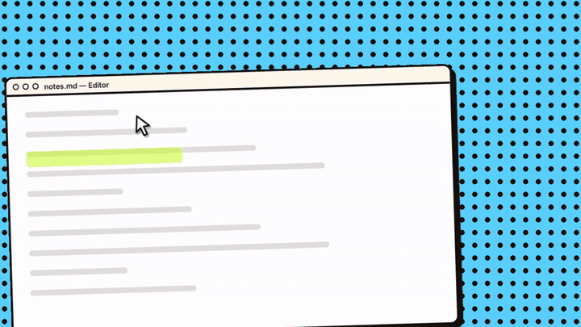
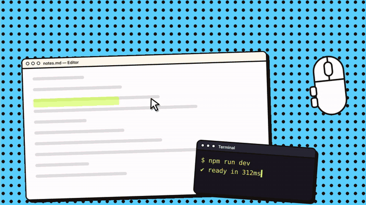

# Getting started

CursorPie puts a radial menu under your pointer. Hold, flick toward an action, release.

## 1. Install

Download the package for your system from the
[latest release](https://github.com/sebastvnd/cursorpie/releases/latest) and follow [Install](install.md).

## 2. Try the gesture

1. Hold the **middle mouse button**, or touch and hold your **trackpad** (see below), for a split second (150 ms by default).
2. Move the pointer toward a slice. It highlights.
3. Release to run it. Release in the center to cancel.

Changed your mind? Release in the center of the pie:

No middle button? Turn on *Open the pie with a trackpad hold* in **Settings > Behavior > Trackpad**, press Save, then touch
and hold the trackpad. See [Trackpad hold](trackpad.md).

## 3. Open Settings

With the pie open (in any ring, in a submenu or in the pie of an app), press **Space**. Settings opens and Space does not
reach the app under the pie. On macOS and Windows you can also use the menu bar or tray icon.

Prefer the old way? Turn on *Open settings by holding* in **Settings > Behavior > Trigger**: keep holding in the center
of the top ring, a progress arc fills around the center disc and Settings opens after 1200 ms.

## 4. What next

| I want to... | Read |
|---|---|
| Learn what a slice can do | [Using the pie](using-the-pie.md) |
| Have a different menu per app | [Profiles and mouse buttons](profiles-and-buttons.md) |
| Chain actions (copy, open, wait, paste) | [Flows](flows.md) |
| Change timings, looks, backups | [Settings and backups](settings.md) |
| Edit `config.json` by hand | [Configuration](configuration.md) |
| Use Linux | [CursorPie on Linux](linux.md) |
| Fix a problem | [Known issues](known-issues.md) |

## Per-system first step

- **macOS:** allow **Accessibility** when asked (a live status is shown in the welcome window).
- **Windows:** CursorPie lives in the system tray.
- **Linux X11:** nothing to set up. **Linux Wayland:** install the udev rule, see [CursorPie on Linux](linux.md).

A short welcome window, drawn in the Gen Z style of the website, opens on the first start; skip it with **Skip** or `Esc`. The file `welcome_shown` next to
`config.json` remembers that it was shown; delete it to see the window again.
