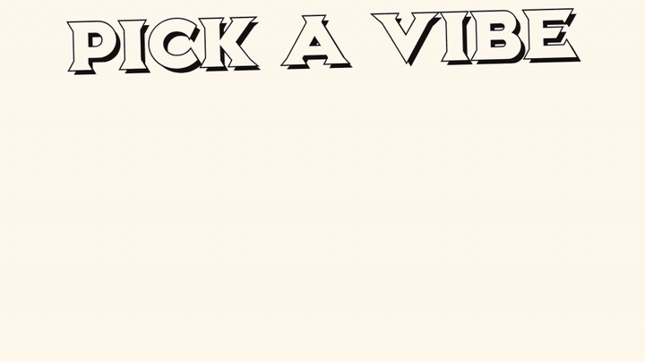

# Themes

A theme is the look of the Settings window and of the Solid pie: colors, the roundness of corners, outlines and
shadows. Pick one in **Settings > Behavior > Look & feel > Theme**.



| Theme | Look |
|---|---|
| **Gen Z** | The default, and the look of the website: warm cream (or violet-tinted black), thick ink outlines, pill buttons and hard shadows without blur, lime accent. |
| **Sage** | The look Settings had before themes: soft sage-green neutrals, a cream page, paper panels, hairlines, soft shadows only under what floats. |
| **Bubblegum** | Gen Z in candy pink: a cotton-candy page, plum ink and outlines, rounder corners, hard shadows, pink accent (berry-tinted black in the dark appearance). |

Choosing a theme also moves the accent color to the theme's own, unless you picked an accent yourself. The colors you
pick under *Colors of the light/dark appearance* are laid over the theme, so they work with every theme, and the
text stays readable on whatever you choose. **Appearance** (System, Light, Dark) still decides which of the two
palettes of the theme is used.

## Make your own theme

A theme is one `.json` file in the themes folder (the **Open themes folder** button creates and opens it; it is
`themes/` next to `config.json`, see [Configuration](configuration.md)). The name of the file, without `.json`, is the
id of the theme: letters, digits, `-` and `_`, up to 48 characters. Press **Reload themes** after saving a file.

A file is a *layer over another theme*: it names the theme it `extends` (`sage` when it says nothing, or `genz`,
`bubblegum` or another file) and lists only what it changes. Everything left out is the base theme's. This is a whole theme:

```json
{
  "name": "Mint Soda",
  "extends": "genz",
  "accent": "#2fd27a",
  "light": { "bg": "#e1faec", "sidebar": "#d0f2e0", "text": "#0e2a1c" },
  "dark": { "bg": "#0f1a14" },
  "shape": { "control_radius": 14, "panel_radius": 20 }
}
```

(also in [`docs/examples/themes/mint-soda.json`](../examples/themes/mint-soda.json)). Colors are `"#rrggbb"`
(`"#rgb"`, `"#rrggbbaa"` and `[r, g, b]` work too). A file with a mistake is skipped, the reason is shown under the
buttons, and the other themes keep working. Fields CursorPie does not know are ignored.

### Fields

| Field | What it is |
|---|---|
| `name` | What the theme list shows (up to 40 characters). |
| `extends` | `sage`, `genz`, `bubblegum` or the id of another file (up to 8 in a row). |
| `accent` | The accent a fresh choice of this theme starts with. |
| `light`, `dark` | The colors of each appearance, below. |
| `shape` | Radii, outlines and shadows, below. |
| `pie` | Colors of the Solid pie: `{"light": {...}, "dark": {...}}` with `slice`, `ghost`, `ink`, `core`. When you set a main color of an appearance, its pie follows it unless you write these. |

**Colors** (`light` / `dark`). Set the four main colors, and the rest of the palette follows them:
`bg` (page), `sidebar`, `card` (panels) and `text`. To set something exactly, also write: `idle`, `hot` (controls at
rest and under the pointer), `input`, `border`, `divider`, `line` (the strong outline and hard-shadow color), `muted`
(secondary text), `good`, `bad`, `scrim`, `track` (rail of switches and sliders), `keycap`. Whatever you write, `text`
and `muted` are moved just far enough from the surfaces to read on all of them.

**Shape.** Radii are in points, up to 36 (a control is 36 high, so 18 makes a pill): `control_radius`, `panel_radius`,
`window_radius`. Outlines are `{"width": 2, "tone": "line"}` with `tone` one of `divider`, `border`, `line` and width
0 to 6 (0 = none): `control_edge`, `chip_edge` (the chosen segment, a key cap), `panel_edge`, `popup_edge`,
`window_edge`, `side_edge` (sidebar line). Shadows are `{"x": 3, "y": 3, "blur": 0, "alpha": 255, "ink": true}`
(`blur` 0 is hard, `ink` casts it in the `line` color, `alpha` 0 removes it): `control_shadow` (buttons at rest),
`panel_shadow`, `popup_shadow`, `window_shadow` (a window shadow that would be cut off is dropped).
Also `window_accent_mix` (0 to 1: how far the window outline leans to the accent), `nav_wash` (0 to 1: strength of the
sidebar highlight) and `nav_icon_accent` (`false`: the chosen sidebar icon uses the text color, for strong washes).
Sizes (control height, spacing) are the same in every theme so that a theme cannot break a layout.

The unknown id of a theme whose file was removed shows as Gen Z and stays in your settings, so the theme is back when
the file is.

The ids `genz`, `sage` and `bubblegum` belong to the themes that ship with CursorPie: a file with one of these names
(a `bubblegum.json` copied from an older version of this page, say) is skipped with a note. Rename the file, and
change its `name`, to keep it.
