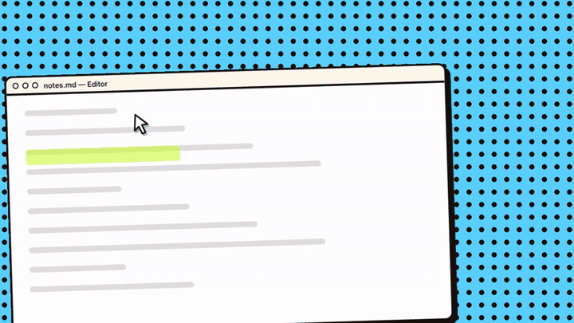
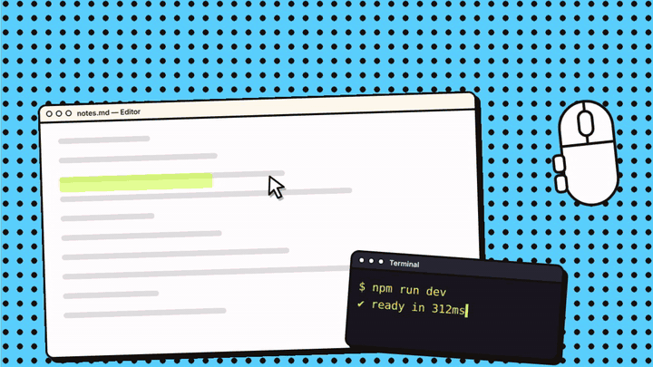
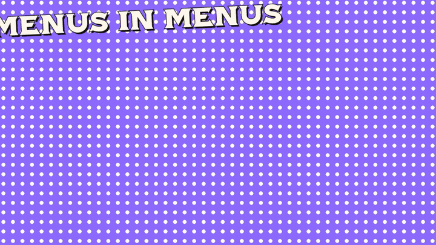

# Using the pie

The everyday part of CursorPie: the gesture, what a slice can do and what you get on a fresh install. For profiles
and mouse buttons read [Profiles and mouse buttons](profiles-and-buttons.md); for building your own menus read
[Settings and backups](settings.md).

## Contents

- [The gesture](#the-gesture)
- [Slices and actions](#slices-and-actions)
- [Icons and look](#icons-and-look)
- [Default setup](#default-setup)

## The gesture

1. **Hold** the trigger (the middle mouse button by default, or a trackpad hold once you turn it on) for 150 ms. The pie opens under the cursor.
2. **Move** toward a slice. It highlights as you hover.
3. **Release** to run it. Release in the center dead zone to cancel.

What else the trigger does:

| You do this | CursorPie does this |
|---|---|
| **Hold** for 150 ms | Opens your general pie under the cursor |
| **Double-click** (default mode) | Opens the pie of the app under the pointer, instantly, if that app has its own profile |
| **Right-click** while the pie is open | Switches which pie the side buttons follow, and the ring changes color at once |
| **Click** quickly | Passes the click through to the app. If the app has its own profile, the click is delivered after the double-click window (260 ms) |
| **Press and drag** before the pie opens | Hands the drag back to the app, so middle-drag panning still works |
| **Release** over a slice | Runs that slice |
| **Drag outward** across the rim of a submenu slice | Opens the submenu, re-centered on the cursor |
| **Keep holding** in the center | After 1200 ms in total, opens Settings. A progress arc fills around the center disc. Can be switched off, see [Opening Settings from the pie](#opening-settings-from-the-pie) |
| **Hold Space** while the pie is open | With the [intelligent pie](intelligent-pie.md) on: turns the pie into a pie of suggestions, and back |
| **Press Esc** while the pie is open | Locks CursorPie (on by default, *Lock with Esc*): the pie closes and nothing runs. Works with the mouse trigger and with a trackpad hold |
| **Hold the trigger, then press Esc** (or **click the left button**, mouse trigger) while CursorPie is locked | Unlocks it and **opens the pie at once**, with the padlock opening in its middle: no need to trigger it again. A press of the trigger while locked opens no pie and goes to the app as if CursorPie were not there; after the hold time a notice says *CursorPie locked* |
| **Press Space** while the pie is open | Opens Settings, if *Open settings with Space* is on (on by default). Works in any ring, in a submenu and in the pie of an app |

In *classic* mode (see [Profiles](profiles-and-buttons.md#profiles)) there is no double-click: holding opens the app's own pie if it has
one, otherwise the general pie. Every timing can be changed in **Settings > Behavior**.

### Opening Settings from the pie

Two ways open Settings while the pie is on screen. Both are in **Settings > Behavior > Trigger** and they are
independent, so either, both or neither can be on:

| Setting | What it does | Default |
|---|---|---|
| *Open settings by holding* | Keep the trigger held in the center of the pie until *Hold to open settings* (1200 ms in total) has passed. Only the untouched top ring counts. Off: the pie never turns into Settings by itself and the progress arc is not drawn | Off |
| *Open settings with Space* | Press Space while the pie is open. Space is taken by CursorPie, so it does not reach the app under the pie | On |
| *Presses of Space* | One press, or two in quick succession (the second within half a second). Two is the most | One press |
| *Lock with Esc* | Esc while the pie is open locks CursorPie; Esc while a locked trigger is held unlocks it. Esc is taken only in those two moments, so it keeps working in your apps | On |

With both on, whichever comes first opens Settings; the other then does nothing. Turning the hold off is for people
who sometimes keep the pie open for a long time and get Settings they did not ask for; Space is the deliberate way in.
With both off, Settings is still in the tray or menu bar icon.

Space works on macOS and Windows. On Linux with X11 it works, but the key also reaches the app under the pie (the keyboard
is only watched there, not taken). On Wayland CursorPie does not see keys, so the setting has no effect.

Esc follows the same limits as Space: it is taken on macOS and Windows; on Linux with X11 the lock works but the Esc key also
reaches the app under the pie; on Wayland CursorPie does not see keys, so Esc does not lock (the three-finger tap of the
trackpad still does).

**Instant flick** is an option: drag right after pressing to open the pie with no hold delay. It disables
middle-drag pass-through in other apps. The trigger is the middle button on every system. Only on macOS can it also be one of three extra mouse buttons.

## Slices and actions

A slice is one of three kinds:

- **Run** does something when you release the button over it.
- **Mode** makes your mouse's back and forward buttons send the actions you assigned to this mode, for example
  Undo and Redo, or Cmd+[ and Cmd+] on macOS and Alt+Left and Alt+Right on Windows. The active mode is
  remembered per profile and shown in the center of the pie. If an action is *None*, the native back or
  forward click passes through. A mode can also give an action to **every other extra button** of your mouse, see
  [Your mouse and its extra buttons](profiles-and-buttons.md#your-mouse-and-its-extra-buttons).
- **Submenu** opens a nested ring. A ring holds up to 8 slices and menus go up to 5 levels deep. A dot on the
  rim marks a submenu.

Actions are available for Run slices and for each side button of a Mode:

| Action | What it does |
|---|---|
| None | Nothing. For side buttons, the click passes through to the app |
| Shortcut | Sends a key combination. Click the button and press the keys to record it (Esc cancels) |
| Open app | macOS: `open -a <name or path>`, for example `Safari` or `/Applications/Safari.app`. Windows: a program name or the path of an `.exe`, for example `chrome` or `C:\Tools\App.exe`. Linux: a desktop-entry id, a program name or a path, or a role that the system fills: `@browser`, `@files` or `@terminal`. If the app already runs on another virtual desktop or Space, CursorPie goes to it |
| Open URL / file | Opens the target with the system, for example `https://example.com` or a file path |
| Shell command | macOS and Linux: `/bin/sh -c "<command>"`. Windows: `cmd /C "<command>"` without a console window |
| Flow | Runs one of your [flows](flows.md): a chain of steps you drew in the **Flow** section |
| Sequence | Several actions in order, 40 ms apart. Edit these in `config.json` (see [Configuration](configuration.md)) |

Actions run on one worker thread, so they always execute in the order you triggered them.

## Icons and look

An icon can be text, an emoji or an image (`.png`, `.jpg`, `.jpeg`, `.webp`); a path may start with `~/`.

- An icon is drawn at no more than about 120 px, so a big image is wasted.
- Choose an image with **Image...** in the icon picker and CursorPie prepares it: up to 512 px and 512 KB it is used as
  it is; a bigger one is shrunk to a 256 px PNG copy in the `icons` folder next to `config.json`. The original is never
  touched and the status bar tells you what happened.
- An image over 40 megapixels or 64 MB, or a file that is not an image, is refused with a message.
- The **Mine** page of the picker lists the images in the `icons` folder (up to 120 files of at most 2 MB each) and says
  how many it left out.
- To delete an image you imported, open the **Mine** page (or **All**) and either drag the image onto the trash strip
  at the bottom of the picker, or point at it and press **Delete** (**Backspace** on a Mac keyboard). Only the copy in
  the `icons` folder is removed, never the original file, and it cannot be undone. A slice that still used it shows
  `?` until you pick another icon, and the status bar says how many did.
- The pie size (140 to 360 px), accent color and sounds are adjustable. An optional soft tick plays when the hovered
  slice changes.

## Default setup

A fresh install comes with three profiles:

| Profile | Apps | Slices |
|---|---|---|
| Default (general) | all apps without a profile | History (undo/redo), Clipboard (copy/paste), Brackets, and a *Launch* submenu with a file manager, terminal, browser and screenshot tool |
| Browsers | The common browsers of your system (on macOS Safari, Chrome, Firefox, Arc, Brave and Edge) | Browser (back/forward), Tabs (previous/next), Zoom, Scroll (Page Up/Down) |
| Code | The code editors of your system (on macOS VS Code and Xcode; on Windows VS Code and Visual Studio; on Linux VS Code and its variants) | History, Brackets, Edit (Return/Delete) |

The Launch submenu and the app ids adapt to your system (for example Finder on macOS, Explorer on Windows and the
file manager, terminal and browser roles on Linux).
